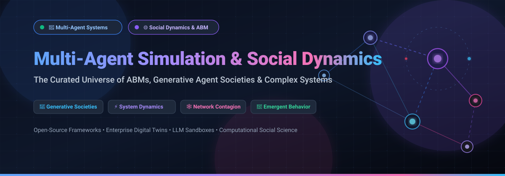

  

# 🌐 Awesome Multi-Agent Simulation & Social Dynamics Ecosystem

**Curated Directory of Enterprise SaaS Platforms & Open-Source Projects for Computational Social Science, Generative LLM Societies, Agent-Based Modeling (ABM) & System Dynamics**

---

## 📑 Table of Contents
- [📌 Overview & SEO Highlights](#-overview--seo-highlights)
- [📊 Sector Overview & Market Dynamics](#-sector-overview--market-dynamics)
- [🏢 SaaS & Hosted Simulation Platforms](#-saas--hosted-simulation-platforms)
- [💻 Open-Source GitHub Projects](#-open-source-github-projects)
- [🤝 How to Contribute](#-how-to-contribute)
- [💖 Support & Sponsorship](#-support--sponsorship)
- [📈 Star History](#-star-history)
- [⚠️ Disclaimer](#️-disclaimer)

---

## 📌 Overview & SEO Highlights

Welcome to the definitive awesome directory on **Multi-Agent Simulation (MAS)**, **Generative Agent Societies**, **Agent-Based Modeling (ABM)**, and **System Dynamics**. Whether you are researching computational economics, epidemiological transmission models, urban transit contagion, or building multi-agent LLM simulations (Smallville simulacra), this repository indexes leading enterprise tools and open-source frameworks.

### 🔍 Key Focus Areas:
- 🤖 **Generative LLM Social Simulations**: Simulating believable human behavior, generative societies, collective memory, reflection, and conversational dynamics.
- 👥 **Agent-Based Modeling (ABM)**: Emergent behavior from bottom-up micro-decisions across grid, spatial GIS, or continuous topologies.
- ⚡ **System Dynamics (SD)**: High-level continuous feedback loops, stocks and flows, and policy testing.
- 🕸️ **Social Network Contagion & Diffusion**: Information cascading, opinion dynamics, polarization, and social dilemma benchmarks.
- 🏭 **Discrete-Event Simulation (DES) & Digital Twins**: Industrial floor planning, healthcare patient pathways, and supply chain stress testing.

---

## 📊 Sector Overview & Market Dynamics

The global simulation software and digital twin market is estimated at **$18.5 Billion to $20.0 Billion** (and projected to reach over **$36.0+ Billion** by 2030, growing at a CAGR of ~11.5%–13.8%). 

The industry exhibits a dual-structured market dynamic: **it is concentrated at the enterprise industrial core**—where established conglomerates dominate mechanical/FEA/process simulation—yet **highly fragmented across emerging multi-agent, generative AI, and computational social dynamics layers**, driven by rapid open-source innovations in LLM-driven behavioral agents, interactive web sandboxes, and decentralized decision-support frameworks.

---

## 🏢 SaaS & Hosted Simulation Platforms

*Enterprise and cloud-hosted simulation suites sorted by estimated corporate scale (annual revenue/valuation in descending order).*

| Platform | Corporate Scale (Est. Revenue / Valuation) | Pricing (Starting Tier) | Free Tier Limit / Trial Duration | Primary Focus & Capabilities |
| :--- | :--- | :--- | :--- | :--- |
| **[Wolfram SystemModeler](https://wolfram.com)** | ~$70M–$150M+ Revenue / ~$800M+ valuation | **$340/year** (Personal/Standard Desktop) or $3,195 perpetual commercial license | **30-day fully functional free trial**; Modelica standard library access included | High-performance Modelica-based cyber-physical simulation and multi-domain system dynamics modeling tightly integrated with Mathematica analytics. |
| **[AnyLogic Cloud](https://anylogic.com)** | ~$23M–$26M Revenue | **$18,990+ perpetual** (or quote-based cloud subscription) | **Free Forever Tier**: AnyLogic Public Cloud allows uploading and running public models (limited to 1 min per single run, 5 min per experiment, 32 MB data limit) | Industry-leading multimethod simulation combining Agent-Based, System Dynamics, and Discrete-Event modeling with browser-based execution. |
| **[Simul8 Cloud](https://simul8.com)** | ~$5M–$11M Revenue *(Minitab acquired)* | **$4,900/year** (Basic Desktop/Cloud seat) | **14-day free trial** with full access to desktop and browser modeling | Cloud and desktop discrete-event and agent-flow simulation optimized for healthcare logistics, manufacturing, and operational throughput. |
| **[Simio Cloud](https://simio.com)** | ~$6M–$10M Revenue *(Acquired by Aegis)* | **$6,000/year** (~$500/month starting commercial license) | **30-day evaluation trial** (plus 100% full-feature Free Academic Grants for educators and researchers) | Enterprise 3D object-oriented agent modeling, digital twin forecasting, and Risk-based Planning and Scheduling (RPS). |
| **[Hash.ai](https://hash.ai)** | ~$2.5M Seed funding (~$12M–$20M valuation) | **$120/seat/month** (Enterprise custom packages) | **Free Forever Tier**: Unlimited public simulations and community blocks for open web-based agent modeling | Modern browser-first multi-agent simulation engine utilizing distributed web computing and structured data block composition. |
| **[Ventana Cloud / Vensim](https://vensim.com)** | ~$1.8M–$3.2M Revenue | **$169 one-time** (Vensim PLE Plus commercial) / $1,195 (Professional) | **Free Forever Tier**: Vensim PLE is completely free for academic/educational use (commercial PLE costs $50) | Decades-proven continuous simulation engine for feedback loop conceptualization, causal tracing, and policy analysis. |
| **[Stella Architect / isee Exchange](https://iseesystems.com)** | ~$440K–$1.2M Revenue | **$389/year** (Standard Stella Designer) or $1,995 perpetual | **30-day free trial** with full simulation execution; free read-only web publishing on isee Exchange | Visual system dynamics suite enabling researchers and educators to publish interactive management flight simulators and browser interfaces. |
| **[Insight Maker](https://insightmaker.com)** | Non-Profit / Community Platform | **$0 (100% Free)** | **Free Forever Tier**: Full unrestricted access to build and run system dynamics & agent models (public model repository) | Zero-cost web-based collaborative modeling canvas supporting agent-based mechanics, causal loop diagrams, and Monte Carlo sensitivity testing. |
| **[NetLogo Web](https://netlogoweb.org)** | University Funded (Northwestern CCL) | **$0 (100% Free / Open Academic)** | **Free Forever Tier**: 100% open and unrestricted in-browser simulations powered by NetLogo's JavaScript engine | Browser-hosted version of Northwestern's legendary multi-agent programmable modeling environment for educational and research simulations. |
| **[Silico / PathFwd](https://silicoai.com)** | £3.4M Seed raised (~$4.5M) | **$750/month** (Enterprise pilot starting rate) | **14-day guided proof-of-concept trial** for business process dynamic simulation | Visual no-code digital twin of the organization (DTO) platform designed to simulate business workflows, cash flows, and policy shocks. |

---

## 💻 Open-Source GitHub Projects

*Top open-source agent-based modeling libraries, generative social simulators, and system dynamics toolkits, sorted in descending order of GitHub stars.*

| Repository | GitHub Stars | Primary Language / Ecosystem | Category & Description |
| :--- | :---: | :--- | :--- |
| **[simstudioai/sim](https://github.com/simstudioai/sim)** |  | TypeScript / Python | 🚀 **AI Agent Orchestration & Simulation Engine**: Modern visual workflow canvas and high-performance execution engine for autonomous multi-agent systems and collaborative behavior testing. |
| **[joonspk-research/generative_agents](https://github.com/joonspk-research/generative_agents)** |  | Python / Django | 🏘️ **Stanford Smallville Generative Simulacra**: Groundbreaking computational simulation of believable human social behavior featuring 25 generative agents living in an interactive sandbox. |
| **[networkx/networkx](https://github.com/networkx/networkx)** |  | Python | 🕸️ **Complex Network Dynamics**: The canonical Python toolkit for analyzing complex topological structures, social network graphs, disease contagion, and rumor diffusion algorithms. |
| **[camel-ai/oasis](https://github.com/camel-ai/oasis)** |  | Python | 📱 **Social Media Sandbox (CAMEL-AI)**: Scalable million-agent social interaction simulator modeling group polarization, echo chambers, herd behavior, and information diffusion across Twitter/Reddit topologies. |
| **[mesa/mesa](https://github.com/mesa/mesa)** |  | Python | 🐍 **Premier Python ABM Framework**: Highly modular library for building agent-based models with grid/network spaces, continuous 2D topologies, data collectors, and Solara interactive browser dashboards. |
| **[Farama-Foundation/PettingZoo](https://github.com/Farama-Foundation/PettingZoo)** |  | Python | 🎮 **Multi-Agent Reinforcement Learning (MARL)**: Multi-agent API standard (Gymnasium equivalent) supporting competitive, cooperative, and mixed social dilemma agent simulations. |
| **[google-deepmind/concordia](https://github.com/google-deepmind/concordia)** |  | Python | 🧠 **Generative Social Dynamics (Google DeepMind)**: Library for generative agent interactions mediated by a master environment model, supporting economic auctions, negotiations, and social psychology experiments. |
| **[tsinghua-fib-lab/AgentSociety](https://github.com/tsinghua-fib-lab/AgentSociety)** |  | Python | 🏙️ **Large-Scale Urban Social Simulator**: Simulates tens of thousands of LLM-driven autonomous agents in realistic urban environments to evaluate consumer habits, mobility patterns, and public policy impact. |
| **[NetLogo/NetLogo](https://github.com/NetLogo/NetLogo)** |  | Scala / Java | 🐢 **Classic Multi-Agent Programmable Environment**: Foundational open-source modeling environment used by hundreds of universities to explore emergent behaviors across biology, economics, and sociology. |
| **[JuliaDynamics/Agents.jl](https://github.com/JuliaDynamics/Agents.jl)** |  | Julia | ⚡ **Ultra-Fast Agent-Based Modeling**: High-performance ABM engine delivering 10x-100x speedups over Python frameworks, with native OpenStreetMap, spatial grids, continuous spaces, and interactive Makie.jl GUIs. |
| **[google-deepmind/meltingpot](https://github.com/google-deepmind/meltingpot)** |  | Python | 🍲 **Social Dilemma Benchmark (Google DeepMind)**: Multi-agent research testbed focusing on mixed-motive games, common-pool resource governance, reciprocal altruism, and collective action problems. |
| **[Axelrod-Python/Axelrod](https://github.com/Axelrod-Python/Axelrod)** |  | Python | 🤝 **Iterated Prisoner's Dilemma Simulator**: Research library implementing over 200 strategies to study the evolution of cooperation, reputation mechanisms, and evolutionary game theory. |
| **[matsim-org/matsim-libs](https://github.com/matsim-org/matsim-libs)** |  | Java | 🚗 **Multi-Agent Transport Simulation**: Large-scale agent-based transport simulator capable of modeling daily travel demand, EV charging networks, congestion pricing, and transit micro-behaviors. |
| **[SDXorg/pysd](https://github.com/SDXorg/pysd)** |  | Python | 📈 **System Dynamics in Python**: Translates Vensim (`.mdl`) and XMILE (`.xmile`) models into executable Python code for scientific computing, MCMC calibration, and coupling with ABMs. |
| **[jofmi/agentpy](https://github.com/jofmi/agentpy)** |  | Python | 🔬 **Scientific Agent-Based Modeling**: Lightweight Python library engineered for scientific exploration, parameter sweeps, statistical experiment design, and seamless integration with NumPy/Pandas. |
| **[javipalanca/spade](https://github.com/javipalanca/spade)** |  | Python | 💬 **XMPP/FIPA Multi-Agent Platform**: Python multi-agent system built upon asynchronous XMPP messaging, featuring BDI (Belief-Desire-Intention) behavioral models and web agent inspectors. |
| **[starsimhub/covasim](https://github.com/starsimhub/covasim)** |  | Python | 🧪 **Epidemiological Agent Simulation**: Highly detailed stochastic agent-based model developed by the Institute for Disease Modeling to evaluate contact tracing, transmission, and quarantine interventions. |
| **[mesa/mesa-geo](https://github.com/mesa/mesa-geo)** |  | Python | 🗺️ **GIS Geospatial Extension for Mesa**: Extends Mesa with GIS capabilities, enabling agents to exist on GeoPandas spatial polygons, point geometries, and raster land-use maps. |
| **[eclab/mason](https://github.com/eclab/mason)** |  | Java | 🧱 **High-Speed Discrete-Event Multi-Agent Core**: Fast, discrete-event multi-agent simulation library designed to support millions of agents with 2D/3D visualization and distributed MPI extensions. |
| **[FLAMEGPU/FLAMEGPU2](https://github.com/FLAMEGPU/FLAMEGPU2)** |  | C++ / CUDA / Python | 🔥 **GPU-Accelerated Massive Agent Simulation**: Real-time CUDA simulation framework unlocking billion-agent simulations across swarm robotics, cellular biology, and pedestrian evacuation. |
| **[gama-platform/gama](https://github.com/gama-platform/gama)** |  | GAML / Java | 🌐 **Spatially Explicit Urban & Environmental ABM**: Comprehensive modeling environment with built-in GIS vector handling, 3D OpenGL rendering, and an expressive agent-oriented scripting language (GAML). |
| **[salesforce/ai-economist](https://github.com/salesforce/ai-economist)** |  | Python | 💰 **Macroeconomic Policy RL Simulation**: Reinforcement learning framework modeling optimal taxation, labor choices, inequality, and emergent trade within multi-agent economies. |
| **[transentis/bptk_py](https://github.com/transentis/bptk_py)** |  | Python | 📊 **Business Prototyping Toolkit**: Python framework uniting System Dynamics and Agent-Based Modeling inside Jupyter notebooks to support corporate strategic scenario modeling. |
| **[Repast/repast4py](https://github.com/Repast/repast4py)** |  | Python / C++ | 🏛️ **HPC Distributed Agent Suite**: Next-generation parallel agent-based modeling system developed by Argonne National Laboratory designed for MPI supercomputer scaling. |

---

## 🤝 How to Contribute

We welcome contributions from researchers, software engineers, and domain specialists in computational social science!

1. 🍴 **Fork the repository** on GitHub.
2. 🌿 **Create a feature branch**: `git checkout -b feature/add-new-simulation-engine`.
3. 📝 **Add your entry** to either the SaaS table or Open-Source table following the established format:
   - For SaaS: verify realistic tier pricing, explicit free tier limits, and estimated company scale.
   - For Open-Source: include the repo link, exact social star badge (`style=social&color=white`) linking to its stargazers page, primary language, and an emoji-led description.
4. 🔀 **Sort your entry** appropriately (SaaS by corporate scale, Open-Source by GitHub stars).
5. 🚀 **Submit a Pull Request** with a concise description of why the tool belongs in this curated ecosystem.

For broader collections of curated tools across tech and AI, explore [Awesome Awesome Awesome](https://github.com/ishandutta2007/Awesome-Awesome-Awesome).

---

## 💖 Support & Sponsorship

If you find this curated multi-agent simulation directory helpful for your research, projects, or organization, please consider supporting the project:

- ⭐ **Star this repository** on GitHub to increase its visibility for fellow researchers!
- 🍴 **Fork and share** with colleagues in computational social science and complexity modeling.
- ☕ **Sponsor the maintainer** or buy a coffee via the [GitHub Sponsor Dashboard](https://github.com/sponsors/ishandutta2007).

Your sponsorship helps keep this ecosystem index up-to-date with emerging research sandboxes and tools!

---

## 📈 Star History

---

## ⚠️ Disclaimer

- This is an independently curated educational directory — not an endorsement of specific commercial products or vendors.
- Multi-agent simulations, generative agent societies, and system dynamics models are inherently sensitive to behavioral assumptions, initial parameter calibration, and LLM prompt stochasticity; simulation outputs represent exploratory scenario hypotheses rather than deterministic forecasts of human social systems.
